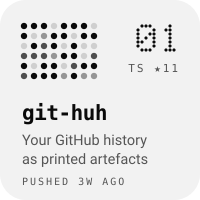
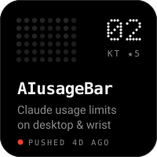
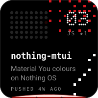

<!-- generated by scripts/build.py, refreshed by .github/workflows/refresh.yml; edit the script, not this file -->

 

 

<a href="https://linkedin.com/in/jaikhuranna">LinkedIn</a> &nbsp;·&nbsp; <a href="https://instagram.com/jaikhuranna">Instagram</a> &nbsp;·&nbsp; <a href="https://twitter.com/commondumlow">Twitter</a>

